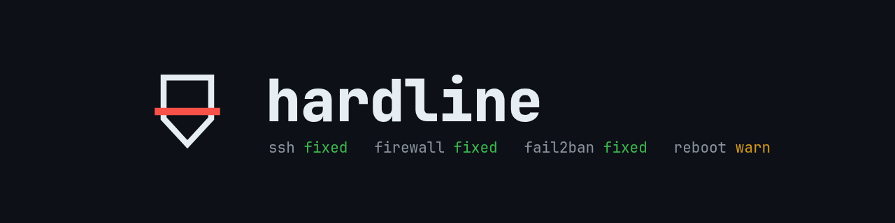
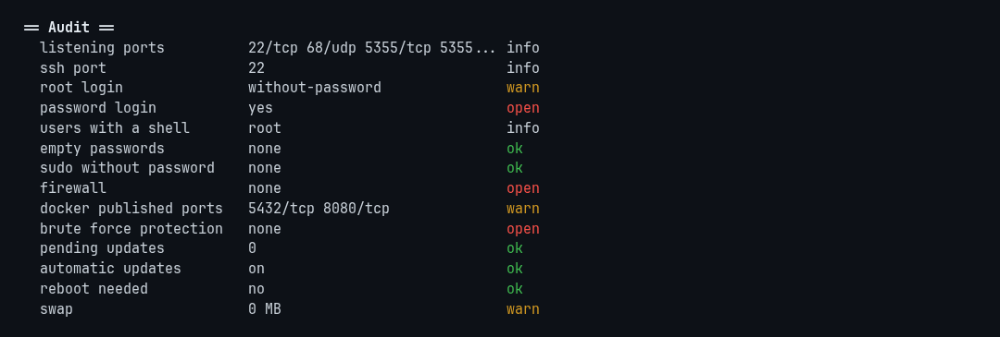
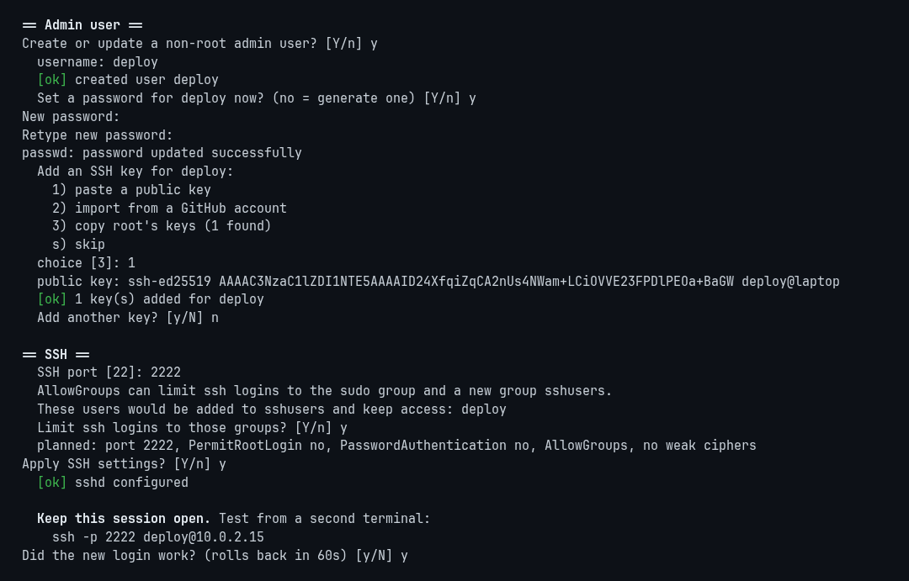
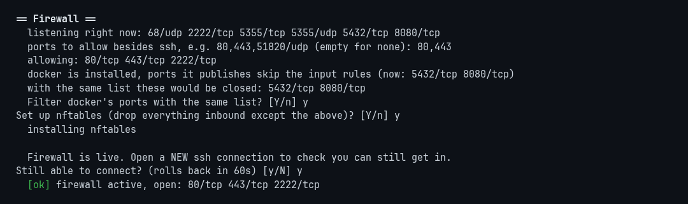
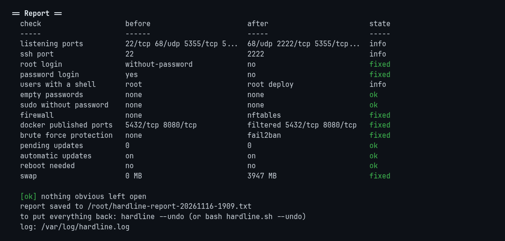
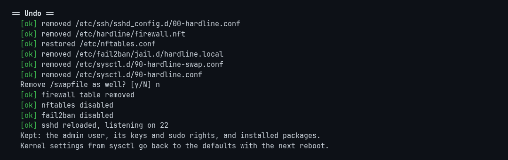

<p align="center"></p>

<p align="center">
  
  
  <a href="https://github.com/instantnodeeu/hardline/releases"></a>
  <a href="https://github.com/instantnodeeu/hardline/stargazers"></a>
  <a href="https://github.com/instantnodeeu/hardline/actions/workflows/vm.yml"></a>
  <a href="https://instantnode.eu"></a>
</p>

hardline takes a fresh VPS from "root with a password on port 22" to something
you can leave on the internet. It's one bash script that asks before every
change, rolls back the risky ones on its own if your connection drops, and at
the end shows you what was open before and what is closed now.

```sh
curl -fsSL https://raw.githubusercontent.com/instantnodeeu/hardline/main/hardline.sh | sudo bash
```

Piping into bash still works interactively, questions are read from `/dev/tty`.
If you'd rather read it first (you should):

```sh
curl -fsSLO https://raw.githubusercontent.com/instantnodeeu/hardline/main/hardline.sh
less hardline.sh
sudo bash hardline.sh --dry-run
```

To keep it around as a `hardline` command, for a re-run after the next distro
upgrade, an `--audit` now and then or `--undo`:

```sh
curl -fsSL https://raw.githubusercontent.com/instantnodeeu/hardline/main/install.sh | sudo sh
sudo hardline --audit
```

Run the install line again to update it.

<p align="center"></p>

## What it does

Every step can be skipped, and running it twice is fine, it only rewrites what
differs.

### Audit

<p align="center"></p>

Listening ports, the effective sshd settings (`sshd -T`, so drop-ins and
cloud-init's `50-cloud-init.conf` count), users with a login shell, empty
passwords, passwordless sudo, firewall, ports published by Docker, brute force
protection, pending and automatic updates, whether the running kernel is older
than the installed one, and swap. `--audit` only reads, it doesn't refresh
package lists or write a log, and exits with 2 when something is `open`, so it
works as a check in cron or monitoring. `--json` gives the same as JSON.

### Admin user and SSH

<p align="center"></p>

Creates a sudo user (or fixes up an existing one), sets a password and adds
SSH keys, pasted, from `github.com/<name>.keys` or copied from root. The
`command="..."` prefix cloud images put on root's keys is stripped.

Then `/etc/ssh/sshd_config.d/00-hardline.conf`: root login off, password login
off, optionally another port, shorter login grace time, dead connections
closed after 10 minutes, and the weak algorithms removed (SHA-1, CBC, the NIST
curves for key exchange, `ssh-rsa` signatures). It removes from the OpenSSH
defaults instead of listing what's allowed, so anything from the last years
still connects, including the post-quantum key exchange where OpenSSH has it.
On RHEL and Fedora crypto-policies already handles this and is left alone.
Optionally `AllowGroups`: only the sudo group and a new `sshusers` group may
log in, and every user that has a shell today is put into `sshusers` so nobody
loses access. Accounts created later by some installer can't log in over SSH
until you add them.

Password login only goes off if a user with a working key exists, and the
config is checked with `sshd -t` before the reload. After the reload you have
60 seconds to log in from a second terminal and say yes. No answer, a no, or a
dropped connection (the timer runs in its own session, so it survives losing
yours) puts the previous config back. Handles Ubuntu's `ssh.socket` and
SELinux port labels.

### Firewall

<p align="center"></p>

Uses ufw or firewalld if they're already running. Otherwise an nftables table
`inet hardline` that drops everything inbound except SSH and the ports you
list, with a per-address rate limit on new SSH connections and DHCPv6 replies
let through (providers that hand out IPv6 by DHCP would otherwise lose it at
the next lease renewal). Same 60 second rollback as SSH, and the rules are
only saved once you confirmed.

Docker publishes ports with DNAT, that traffic takes the forward path and an
input firewall never sees it. If Docker is installed, hardline shows which
published ports your list would close and offers a second chain that applies
the same list there, matched on the port the client connected to. Containers
talking to each other are not affected. With `--yes` this needs `--docker`.

### Brute force, updates, swap, time

fail2ban (default) or crowdsec with the nftables bouncer. fail2ban gets the
systemd backend where there is no `/var/log/auth.log`. Pending updates are
installed, then unattended-upgrades, dnf-automatic or a daily `apk upgrade`
(Arch gets a reminder instead, on purpose). A swapfile if there is none, sized
by RAM and btrfs aware. Timezone, NTP, and sysctls: syncookies, loose
rp_filter, no redirects or source routing, kernel pointers and `dmesg` for
root only, no eBPF for normal users, protected fifos and regular files.

### Report

<p align="center"></p>

Before and after in the terminal and in `/root/hardline-report-<date>.txt`,
with the changed files and anything you should still do by hand.

### Undo

<p align="center"></p>

`hardline --undo` puts the original files back, removes the ones hardline
created, deletes the firewall table, turns off the services it turned on and
reloads sshd (opening the old port in ufw/firewalld first, if sshd goes back
to it). It keeps a checksum of every file it wrote, so a file you edited
afterwards isn't overwritten silently: it shows the diff and asks, and with
`--yes` it leaves the file alone. The admin user, its keys and sudo rights and
installed packages stay. The swapfile only goes if you say so.

## Supported systems

Every push and once a week, [GitHub Actions](https://github.com/instantnodeeu/hardline/actions/workflows/vm.yml)
boots the official cloud image of each of these in QEMU/KVM and runs
[`tests/vm.sh`](tests/vm.sh): both rollbacks with a killed connection, a full
run, checks from outside the VM (SSH, closed and open ports, Docker ports on
Debian 13), a second run that must not change anything, a reboot and `--undo`.

| Family | Tested on | Notes |
| --- | --- | --- |
| Debian / Ubuntu | Debian 12, 13, Ubuntu 22.04, 24.04, 26.04 | |
| RHEL | AlmaLinux 9, 10, Fedora 45 | fail2ban comes from EPEL on Alma/Rocky |
| Arch | Arch Linux | no automatic updates on purpose |
| Alpine | Alpine 3.24 | needs `apk add bash` first, OpenRC |
| openSUSE | Leap 16.0 | no automatic updates yet |

## Options

| Flag | |
| --- | --- |
| `-y`, `--yes` | don't ask, use flags and defaults |
| `-n`, `--dry-run` | print what would change, change nothing |
| `--audit` | only print the audit, exit 2 if something is open |
| `--json` | the audit as JSON, same exit code |
| `--undo` | put back what hardline changed |
| `--user NAME` | admin user to create or update |
| `--key "KEY"` | public key for that user |
| `--github NAME` | import keys from `github.com/NAME.keys` |
| `--copy-root-keys` | copy root's `authorized_keys` |
| `--ssh-port PORT` | move sshd |
| `--ssh-groups` | only the sudo group and `sshusers` may log in over SSH |
| `--allow LIST` | extra ports, e.g. `80,443,51820/udp,8000-8100` (tcp if no protocol) |
| `--docker` | filter ports published by Docker with the same list |
| `--brute TOOL` | `fail2ban`, `crowdsec` or `none` |
| `--no-updates` | skip the updates step |
| `--swap SIZE` | `2G`, `1024M`, or `no` |
| `--timezone TZ` | e.g. `Europe/Berlin` |
| `--skip LIST` | any of `user,ssh,firewall,bruteforce,updates,swap,extras` |
| `--no-color` | plain output (also respects `NO_COLOR`) |

Non-interactive example for provisioning:

```sh
sudo bash hardline.sh --yes --user deploy --github yourname --ssh-port 2222 --allow 80,443 --docker
```

With `--yes` there is nobody to confirm a login, so the rollback timers are
off. The admin user step is skipped unless `--user` is given, and SSH password
login stays on if no key can be found.

## Files it touches

Every file it changes is copied to `<file>.hardline.bak` first (only once, so
the backup is always the original). What it wrote, with checksums, and which
services it enabled is listed in `/etc/hardline/manifest` for `--undo`.
Everything is logged to `/var/log/hardline.log`.

```
/etc/ssh/sshd_config.d/00-hardline.conf
/etc/ssh/sshd_config                      Include line, old Port line commented out
/etc/hardline/firewall.nft
/etc/nftables.conf                        /etc/sysconfig/nftables.conf on RHEL, /etc/nftables.nft on Alpine
/etc/fail2ban/jail.d/hardline.local
/etc/apt/apt.conf.d/20auto-upgrades       52hardline-reboot if you opt in
/etc/periodic/daily/hardline-apk-upgrade
/etc/sudoers.d/10-hardline-wheel          Arch and Alpine only
/etc/sysctl.d/90-hardline.conf
/etc/sysctl.d/90-hardline-swap.conf
/etc/fstab, /swapfile
/etc/hardline/manifest
```

## Things to know

- Debian's `nftables.service` runs `nft flush ruleset` when stopped, which also
  wipes Docker's rules. Restart Docker after stopping it.
- Keep your current SSH session open until you've logged in a second time.
  The rollback covers a dropped connection, not a closed laptop lid an hour
  later.
- `--undo` can't reset kernel settings that are already loaded, they go back to
  the defaults with the next reboot.
- In containers without an init system, service steps are skipped. Useful for
  testing, not much else.

## License

MIT, see [LICENSE](LICENSE). Made by [InstantNode](https://instantnode.eu).
